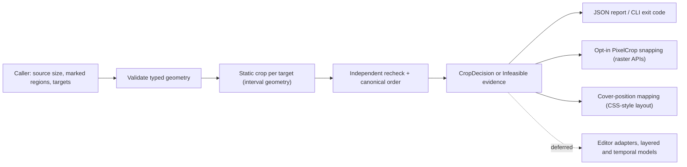

# FrameMotive architecture

**Status:** design only. The M0 contract is accepted (ADR-001 to ADR-004). The initial-scope update in this document and [ADR-005](decisions/ADR-005-initial-scope-static-cropping.md) is **proposed** and awaits review. No crop operation is implemented; the crate exposes no public API yet. Every API, CLI and JSON example below is a proposal.

Contents:

1. [Problem statement and scope](#1-problem-statement-and-scope)
2. [Requirements](#2-requirements)
3. [Public API and CLI design](#3-public-api-and-cli-design)
4. [Domain model and invariants](#4-domain-model-and-invariants)
5. [Modules and responsibility boundaries](#5-modules-and-responsibility-boundaries)
6. [Data flow and processing lifecycle](#6-data-flow-and-processing-lifecycle)
7. [Algorithms](#7-algorithms)
8. [File formats and compatibility](#8-file-formats-and-compatibility)
9. [Errors, diagnostics and reporting](#9-errors-diagnostics-and-reporting)
10. [Performance and resources](#10-performance-and-resources)
11. [Security and robustness](#11-security-and-robustness)
12. [Dependencies and alternatives](#12-dependencies-and-alternatives)
13. [Testing strategy](#13-testing-strategy)
14. [Initial usable implementation slice](#14-initial-usable-implementation-slice)
15. [Deferred functionality and non-goals](#15-deferred-functionality-and-non-goals)
16. [Open technical questions](#16-open-technical-questions)

---

## 1. Problem statement and scope

Image and video pipelines routinely produce several renditions of one visual: 9:16 and 1:1 social variants of a 16:9 shot, 4:5 and 1:1 product images, signage and thumbnail sizes. The usual tools pick a crop from one focal point or a saliency estimate and always return *something*. When a product, logo, face or caption must stay visible, nobody learns that a rendition clipped it until a person looks.

FrameMotive computes, for each target canvas, the largest source crop at the target aspect ratio that keeps every caller-marked required region visible, honors margins, a target safe rectangle and an upscale limit, and then prefers lower-priority regions and a focus point. If no such crop exists, it says so, with numbers: which regions conflict, by how many pixels, and what relaxation would be needed. It never silently cuts a required region.

**In scope (initial plan, M0 + M1):** one static, full-bleed, axis-aligned source visual; caller-supplied rectangles; one or many target canvases; hard and soft constraints with measured violations; explicit invalid and infeasible results; deterministic, bit-reproducible decisions; a versioned JSON report and CLI; integer-pixel and CSS-style mappings for common image and layout systems.

**Boundary.** The core accepts geometric *descriptions*, not files or pixels, and returns *decisions*, not media. Media decoding, subject detection, rendering and encoding stay with the caller and existing tools. Callers decide what matters; the library never classifies image content.



### Where it sits among existing tools

| Existing tool | What it already does | Why this library is still useful |
| --- | --- | --- |
| Focal-point crops ([sharp](https://sharp.pixelplumbing.com/api-resize), [imgix](https://docs.imgix.com/apis/rendering/focalpoint-crop), [Cloudinary `g_auto`](https://cloudinary.com/documentation/resizing_and_cropping)) | One focal point or saliency gravity per crop. Requests for multiple focal points recur, for example [sharp#2740](https://github.com/lovell/sharp/issues/2740). | Multiple required regions, priority tiers, and a refusal with evidence instead of a best-effort crop. |
| Saliency croppers ([smartcrop.js](https://github.com/jwagner/smartcrop.js), libvips `attention`) | Guess what matters from pixels. | Complementary: their boxes can be FrameMotive input. FrameMotive does not guess. |
| [MediaPipe AutoFlip](https://github.com/google-ai-edge/mediapipe/blob/master/docs/solutions/autoflip.md) | Saliency-aware video reframing; legacy support ended in 2023. | Caller-defined constraints and inspectable static decisions; no detection to maintain. |
| [Adobe Premiere Auto Reframe](https://helpx.adobe.com/premiere/desktop/add-video-effects/commonly-used-effects/add-auto-reframe-effect-to-a-sequence.html) | Editable reframing inside one editor. | A library for pipelines outside that editor. |
| [Rust `geo`](https://docs.rs/geo/latest/geo/), [`kurbo`](https://docs.rs/kurbo/latest/kurbo/) | General geometry. | The crop model needs only rectangles and one affine map; the value is the constraint semantics and evidence. |

The distinction is testable: when a caller's regions fit comfortably, FrameMotive's crop resembles a crop centered on the union of the regions. Its value is concentrated where regions are spread out, near edges, constrained by a safe area or upscale limit, or impossible. Section 16 records how that is measured.

## 2. Requirements

The complete, numbered requirements are in [requirements.md](requirements.md). Summary:

### Functional

| ID | Requirement | Milestone |
| --- | --- | --- |
| F-01 – F-07 | Accepted M0 contract: validated canvases and regions, maximal target-aspect crop containing all required regions, soft/hard margin, safe rectangle T, `max_upscale`, focus, explicit `Solved` / `InvalidInput` / `Infeasible`, typed editable decision, runnable example. | M0 |
| M1-01 | Several targets per request; each evaluated independently and identically to a single-target request. | M1 |
| M1-02 | Preferred regions in priority tiers; tiers kept in order while hard constraints remain feasible; dropped regions reported with visible fraction. | M1 |
| M1-03 | Measured results for every soft constraint: margin shortfall, dropped regions, focus offset. | M1 |
| M1-04 | Infeasibility evidence: binding regions, conflicting interval terms, gap in source pixels, needed relaxation (aspect bound, upscale limit, achievable margin), unvalidated fit/pad alternative. | M1 |
| M1-05 | Versioned JSON request and report; CLI with stable exit codes. | M1 |
| M1-06 | Opt-in integer `PixelCrop` snapping with revalidation; never reports a violated hard constraint as satisfied. | M1 |
| M1-07 | Cover-position mapping for CSS-style `object-fit: cover` layout. | M1 |
| M1-08 | Determinism: the same request and algorithm version produce bit-identical output on every checked platform; target and diagnostic order canonical. | M1 |

### Nonfunctional

- **Determinism (N-01):** `f64` with IEEE-754 basic operations, `sqrt`, and (snapping only) `floor`/`ceil`; no fused multiply-add or transcendental functions; −0.0 normalized; golden fixtures store `to_bits` hex; release gate on Linux x86_64, Linux aarch64, macOS and Windows.
- **Numerical safety (N-02):** exact input validation; ADR-002 tolerance only for post-computation checks.
- **Explicit outcomes (N-03):** `Solved`, `InvalidInput`, `Infeasible`; `Unsupported` and `Indeterminate` stay reserved.
- **Performance (N-04):** O(n log n) per target in the number of regions; no allocation proportional to pixel count.
- **Portability (N-05):** stable Rust, no native dependencies.
- **Robustness:** no panic, unbounded allocation or unbounded recursion on any input, including untrusted JSON.
- **API stability (N-07):** pre-1.0 semver; the JSON schema is versioned separately from the crate.
- **Rust quality bar:** MSRV Rust 1.94 (edition 2024; toolchain pinned to 1.94.1), `unsafe_code = "forbid"`, `missing_docs = "deny"`, clippy pedantic with `-D warnings`, rustfmt, rustdoc with warnings denied, `cargo deny` for advisories, licences, bans and sources. All run by `scripts/check.sh`. When library code lands, add `clippy::unwrap_used`, `expect_used`, `panic` and `indexing_slicing` denies for non-test code.

## 3. Public API and CLI design

**Proposed.** Names follow ADR-003; exact signatures are settled in issues F-02 and F-03 and reviewed with code.

### Library

```rust
use framemotive::{
    crop, crop_batch, Canvas, CropBatch, CropOutcome, Margin, Rect, Region, Requirement, SnapPolicy,
    Target,
};

// Proposed API; not implemented.
let source = Canvas::new(1920, 1080)?;                       // Result<Canvas, GeometryError>
let product = Region::new("product", Rect::new(1200.0, 300.0, 200.0, 500.0)?)?; // required by default
let logo = Region::new("logo", Rect::new(1700.0, 60.0, 160.0, 80.0)?)?
    .with_requirement(Requirement::Preferred { tier: 1 });

let batch = CropBatch::new(source)
    .regions([product, logo])
    .margin(Margin::soft(24.0))
    .target(Target::new("story", Canvas::new(1080, 1920)?).max_upscale(2.0))
    .target(Target::new("square", Canvas::new(1080, 1080)?));

for result in crop_batch(&batch).results()? {             // Err(..) only for batch-level invalid input
    match &result.outcome {
        CropOutcome::Solved(decision) => {
            let px = decision.snap(SnapPolicy::Outward);   // opt-in integer crop for raster APIs
            // px.rect() -> (x, y, width, height) as u32; px.diagnostics() report any revalidation issue
        }
        CropOutcome::Infeasible(report) => { /* report.evidence(): binding regions, gap, relaxation */ }
        CropOutcome::InvalidInput(diagnostics) => { /* field paths and IDs */ }
    }
}

// Single target, exactly the accepted M0 operation:
let outcome: CropOutcome = crop(&request);   // request: CropRequest
```

Surface, deliberately small:

| Item | Kind | Notes |
| --- | --- | --- |
| `Canvas`, `Rect`, `Point` | validated value types | Constructors check local invariants (finite, positive, range) and return `Result`. |
| `Region`, `Requirement` | value types | `Requirement::Required` (default) or `Preferred { tier: u8 }`; lower tier number = higher priority. |
| `Margin`, `MarginMode` | value types | `Margin::soft(px)`, `Margin::hard(px)`; absent margin is zero. |
| `CropRequest` | request | Exactly the M0 request (one target). |
| `Target`, `CropBatch` | request | Shared source, regions, margin, focus; per-target canvas, safe rectangle, `max_upscale`. |
| `crop(&CropRequest) -> CropOutcome` | function | Pure, total: never panics, never returns `Result`. |
| `crop_batch(&CropBatch) -> BatchOutcome` | function | `BatchOutcome::InvalidInput` for shared-field or batch-level errors; otherwise one `TargetResult` per target in input order. |
| `CropOutcome`, `CropDecision`, `InfeasibleReport` | results | Tagged; a decision exists only when solved. |
| `Diagnostic`, `DiagnosticCode`, `Severity`, `Measurement` | evidence | `#[non_exhaustive]` enums; stable snake_case code strings. |
| `PixelCrop`, `SnapPolicy` | integration | Integer crop, per-axis scale, revalidation diagnostics. |
| `CropDecision::cover_position()` | integration | Normalized `(px, py)` in `[0, 1]` for `object-position`-style layout. |
| `ALGORITHM_ID` | constant | `"framemotive.static-crop/1"`, also carried in every decision. |

No traits for solver backends, no builder macros, no generic coordinate algebra. Public structs keep fields private and expose accessors so invariants cannot be bypassed; enums intended to grow are `#[non_exhaustive]`.

### CLI

Behind the `cli` feature, binary `framemotive`:

```text
# Proposed CLI; not implemented.
framemotive crop REQUEST.json [--output REPORT.json] [--format json|text]
                              [--snap outward|nearest] [--fail-on dropped,shortfall]
framemotive check REQUEST.json        # validate only; no crop computed
framemotive --version                 # crate version, algorithm ID, schema versions
```

`REQUEST.json` may be `-` for standard input. The report goes to standard output unless `--output` is given; human-readable `text` lists one line per target and diagnostic.

| Exit code | Meaning |
| --- | --- |
| 0 | Every target `Solved`, and no soft result matched `--fail-on`. |
| 1 | At least one target `Infeasible`, or a soft result matched `--fail-on`. |
| 2 | `InvalidInput` (any level), including a malformed or wrong-version document. |
| 3 | Usage or I/O error (missing file, unwritable output, input over size limit). |

If several apply, the highest code wins. A report is still written for codes 1 and 2.

## 4. Domain model and invariants

### Accepted M0 types (ADR-003)

| Concept | Meaning and invariant |
| --- | --- |
| `Canvas` | Width and height as `u32`, each in `1..=65_536`; origin at top left. |
| `Rect` | Finite `x, y, width, height` in continuous pixel-edge units; positive representable width/height; half-open `[x,x+w) × [y,y+h)`. |
| `Region` | Nonempty, request-unique caller ID and source-space rectangle. Partly outside the source: clipped to the visible portion with a `region_clipped` diagnostic carrying the original bounds; wholly outside: `InvalidInput`; clipped below the ADR-002 resolution threshold: `InvalidInput`. |
| `CropRequest` | Source canvas, target canvas, regions, one finite nonnegative source-pixel margin (soft by default; optional `hard` mode), optional finite in-source focus point, optional finite `max_upscale > 0`, optional target-space safe rectangle T (finite, inside the target canvas, positive extent). |
| `CropDecision` | Source crop, target bounds, uniform scale and translation, algorithm ID, constraint results. |
| `Diagnostic` | Stable code, severity, affected IDs, measured values, message. |
| `CropOutcome` | `Solved(CropDecision)`, `InvalidInput(Vec<Diagnostic>)`, `Infeasible(InfeasibleReport)`. |

### M1 additions (ADR-005)

| Concept | Meaning and invariant |
| --- | --- |
| `Requirement` | `Required` (hard; the M0 meaning) or `Preferred { tier }`, `tier: u8`. Tier 0 is the highest preference. |
| `Target` | Request-unique nonempty ID, target canvas, optional safe rectangle T, optional `max_upscale`. |
| `CropBatch` | Source canvas, regions, margin, optional focus, and 1..=N targets. Expanding it yields one `CropRequest` per target; no other state. |
| `BatchOutcome` | `InvalidInput(Vec<Diagnostic>)` for shared or batch-level errors, else `Evaluated(Vec<TargetResult>)` in target input order. |
| `ConstraintResult` | One per constraint instance: ID, kind (`region`, `margin`, `safe_rect`, `max_upscale`, `focus`), hardness, status (`satisfied`, `shortfall`, `dropped`) and measurements. |
| `InfeasibleReport` | Supported model name (`infeasible_for_supported_crop_model`), failing axis or limit, conflicting terms, binding region IDs, gap, needed relaxation, fit/pad alternative. |
| `PixelCrop` | Integer `x, y, width, height` within the source canvas; per-axis scales `sx = tw/width`, `sy = th/height`; aspect error; revalidation diagnostics. |

### Invariants checked independently after every solve

For a `Solved` decision with crop `C = (cx, cy, cw, ch)`, scale `s`, source `W × H`, target `tw × th`, and tolerance `ε = epsilon_px(L)` from ADR-002:

1. **Source containment:** `0 ≤ cx`, `cx + cw ≤ W`, and the same for y, within ε.
2. **Aspect and cover:** `s = tw / cw` and `|s × ch − th| ≤ ε` in target space.
3. **Maximality:** `cw = W` or `ch = H` (both when source and target aspect are equal).
4. **Required visibility:** every clipped required region lies inside C within ε.
5. **Kept preferred visibility:** every preferred region reported as kept lies inside C within ε.
6. **Hard margin:** in hard mode, every kept region's achieved margin on every edge is at least `m − ε`.
7. **Safe rectangle:** every required and kept region mapped by `p ↦ s × (p − (cx, cy))` lies inside T within ε.
8. **Upscale:** `s ≤ max_upscale` when set.
9. **Lexicographic optimality:** no kept tier can be added, achieved margin cannot be increased, and the crop center cannot move nearer the focus without violating a higher-priority term (checked by the oracle in tests, section 13).
10. **Canonical output:** no −0.0; diagnostics sorted by code then UTF-8 subject ID; targets in input order.

A violation of 1–8 inside the library is a bug: the solve returns no `Solved` result and a debug assertion fires in tests. The library never reports a failed recheck as success.

### Coordinate contract (accepted, ADR-002)

- Source and region geometry are in display-oriented, square-pixel space: the caller has applied sample aspect ratio and rotation metadata, and dimensions are display dimensions, not coded dimensions.
- Pixel-edge coordinates use `(0,0)` at the top-left outer edge. A `1920 × 1080` source occupies `[0,1920) × [0,1080)`; its center is `(960,540)`.
- `Rect` values may be fractional. The core does no implicit rounding. ADR-002 defines the canvas bound, exact input validation, minimum required-region extent, and post-computation tolerance. Integer conversion happens only through the explicit snapping step (ADR-005), which revalidates.
- A crop `C = (cx, cy, cw, ch)` maps a source point to target by `p_target = s × (p_source − (cx,cy))`, with `s = target_width/cw`. The target bounds start at `(0,0)`. Reconstruct the target height as `s × ch` and compare it with `target_height` in target pixel units using ADR-002's tolerance.
- Time is absent.

## 5. Modules and responsibility boundaries

One library crate (`framemotive`) with an optional binary. No workspace.

| Module | Responsibility | Depends on |
| --- | --- | --- |
| `lib.rs` | Public re-exports, crate docs, `ALGORITHM_ID`. | all |
| `geometry` | `Canvas`, `Rect`, `Point`, interval helpers, ADR-002 tolerance. No knowledge of requests. | — |
| `request` | `Region`, `Requirement`, `Margin`, `CropRequest`, `Target`, `CropBatch`; batch expansion. | `geometry` |
| `validate` | Request-level validation and region clipping; collects all diagnostics in one pass. | `geometry`, `request`, `diagnostics` |
| `crop` | The analytic per-axis algorithm: maximal crop, hard interval, tier selection, margin `m*`, focus clamp, infeasibility evidence. | `geometry`, `request`, `diagnostics` |
| `verify` | Independent invariant checker (section 4) using only the request and the candidate decision, never the solver's intermediates. Used before returning `Solved` and by tests. | `geometry`, `request` |
| `outcome` | `CropOutcome`, `CropDecision`, `ConstraintResult`, `InfeasibleReport`, `BatchOutcome`, canonical ordering and −0.0 normalization. | `geometry`, `diagnostics` |
| `diagnostics` | `Diagnostic`, `DiagnosticCode`, `Severity`, `Measurement`, `Subject`. | — |
| `snap` | `PixelCrop`, `SnapPolicy`, revalidation; the only module allowed `floor`/`ceil`. | `geometry`, `outcome`, `verify` |
| `json` (feature `json`) | Versioned request/report documents as separate serde DTOs, conversion to and from domain types, input limits. | `serde`, `serde_json` |
| `bin/framemotive.rs` (feature `cli`) | Argument parsing, I/O, exit codes, text rendering. No geometry. | `json`, `clap` |

Rules: `crop` never constructs output that `verify` has not passed; `json` never bypasses `validate`; the binary contains no crop logic. Modules split further only when tests or invariants benefit.

## 6. Data flow and processing lifecycle

1. **Input.** A caller builds a `CropRequest` or `CropBatch` in Rust, or the CLI reads a JSON document (size-limited) and converts DTOs to domain values. Type errors become `malformed_document` diagnostics with line and column.
2. **Validation.** Local invariants are enforced by constructors. Request-level checks (bounds, duplicate IDs, focus inside source, margin, `max_upscale`, T inside target) run in one pass that collects every diagnostic. Regions partly outside the source are clipped and reported. Any error yields `InvalidInput` and stops that request (or the batch, for shared fields).
3. **Per-target solve** (independent; order of evaluation does not affect results):
   1. maximal crop size `cw × ch` and scale `s`; `s > max_upscale` → `Infeasible`;
   2. hard interval per axis from source bounds, required-region union, T and hard margin; empty → `Infeasible` with evidence;
   3. preferred tiers in order, each kept only if the hard interval stays nonempty;
   4. soft margin `m*` over the kept union;
   5. focus clamp;
   6. assemble decision and constraint results.
4. **Recheck.** `verify` checks invariants 1–8; then canonicalization (ordering, −0.0).
5. **Integration (optional).** `snap` converts a decision to a `PixelCrop` and rechecks; `cover_position` maps it to layout parameters.
6. **Report.** Library callers receive typed outcomes. The CLI serializes a versioned report and computes the exit code.

The request is never mutated. No global state, clocks, randomness, environment lookups or thread pools are involved; the same input always gives the same bytes.

## 7. Algorithms

### 7.1 Accepted M0 geometry (ADR-003)

For source size `W × H` and target aspect `r = target_width / target_height`, choose the **largest area** source crop at aspect `r`:

- If `W/H >= r`, set `crop_height = H` and `crop_width = rH`.
- Otherwise set `crop_width = W` and `crop_height = W/r`.

Clip each required region to the source bounds (`region_clipped` diagnostic with original bounds when it changes); a wholly outside region, or one clipped below the minimum extent, is `InvalidInput`. Let `U` be the bounding union of the clipped, unexpanded regions. Report `s = target_width / crop_width`; since the crop is maximal, `s` is the minimum achievable scale, so `s > max_upscale` (if set) is `Infeasible` with measured scale and limit. A negative or nonfinite margin `m` is `InvalidInput`.

Select the origin per axis lexicographically (x shown; y uses top/bottom and heights):

```
(a) hard interval  Hx = [0, W − cw] ∩ [U.right − cw, U.left]
                        ∩ [U.right − T.right/s, U.left − T.left/s]     (last term only with safe rectangle T)
(b) soft margin: dL = U.left, dR = W − U.right (distances to source edges). For m' ∈ [0, m]:
      lo(m') = max(a, U.right + min(m', dR) − cw)
      hi(m') = min(b, U.left − min(m', dL))
      M(m')  = [lo(m'), hi(m')]
    m* = largest m' ∈ [0, m] with lo(m') ≤ hi(m'); select within M(m*)
(c) x = clamp(focus_x − cw/2, M(m*))
```

`m*` exists because `M(0) = Hx`, nonempty whenever the request is not `Infeasible`. `lo` is nondecreasing and `hi` nonincreasing in `m'`, both piecewise linear with breakpoints at `dL` and `dR`, so `m*` has a closed form: evaluate at the breakpoints, then solve the linear segment. Priority is explicit: hard constraints, then maximize achieved margin (equal on both sides up to source-edge caps), then focus. Focus never reduces achieved margin.

Focus is the preferred focus if supplied; otherwise the center of `U` if any regions exist; otherwise the source center. Interval clamping yields a unique origin, so no tie rule is needed. An empty `Hx` or `Hy` means no crop at the target aspect and maximal size can preserve the required regions (or, with T, map them inside the safe rectangle); the diagnostic names the safe rectangle when T bounds cause the emptiness. Margin is soft by default: the largest achievable margin `m*` is used, even when `m* < m`, and the result is still `Solved`. In `hard` margin mode, `m* < m` (including a margin extending past a source edge) is `Infeasible` (report region ID, margin, edge). Compare the margin with edge distances before expansion so a very large finite margin cannot overflow intermediate geometry. Always report, per region and per edge, the achieved margin (distance from region edge to crop edge) and any shortfall versus the requested `m` (not `m*`); shortfall arises from source edges or crop size. Return the crop and the affine mapping above. With no required regions, `U` is undefined and the region-containment, safe-rectangle and margin terms are vacuous: `Hx = [0, W − cw]` (source bounds only; the `max_upscale` check still applies), margin achieved/shortfall reporting is empty, and focus defaults to the source center (or the preferred focus), giving a deterministic source-center or preferred-focus crop.

**Critical limitation:** this proves feasibility only for the supported operation class: a maximal, full-bleed, axis-aligned source crop with no padding. It does not prove that no other creative solution exists. A failure says `infeasible_for_supported_crop_model` and suggests neither hidden solver capability nor global impossibility. Every `Infeasible` result also carries a diagnostic reporting the whole-source fit geometry as an **unvalidated alternative**, with bar sizes in target pixels: `s_fit = min(tw/W, th/H)`, centered, horizontal bars total `tw − s_fit·W`, vertical bars total `th − s_fit·H`, split equally. The diagnostic includes the fit's check against each hard constraint: `max_upscale` (violated if `s_fit > max_upscale`) and safe rectangle T (every required region mapped by the fit transform must lie inside T). It says "fit/pad satisfies the hard constraints" only when every check passes; otherwise it lists the violated constraint(s). It is never a returned decision.

### 7.2 Multiple targets (M1)

`crop_batch` validates shared fields once, then expands the batch into one `CropRequest` per target (shared source, regions, margin and focus; that target's canvas, T and `max_upscale`) and calls the M0 operation on each. There is no cross-target coupling: a target's result is bit-identical to calling `crop` on its expanded request, which is also a test property. Shared validation runs once so a bad region is reported once, not per target.

### 7.3 Preferred regions in priority tiers (M1)

Required regions define the hard interval exactly as in 7.1. Preferred regions are then considered tier by tier, lowest tier number first:

```
kept = required regions
for tier in ascending order:
    candidate = kept ∪ regions in this tier
    if hard interval for candidate (source, union, T, hard margin) is nonempty on both axes:
        kept = candidate                 # tier kept whole
    else:
        report every region in the tier as dropped
```

Regions marked `Required` are never dropped; this is how issue S-04's "priority-based dropping" is realized (ADR-005). Tiers are all-or-nothing: either every region in a tier is kept or none is. This makes the result independent of region IDs and input order (open question 2 records the alternative). Because each tier is tested against an interval that only narrows, the outcome is the lexicographically best set of tiers: keeping a later tier never displaces an earlier one. Union extension is incremental, so the loop costs O(n) after sorting regions by tier.

After the loop, soft margin (7.1 b) and the default focus use the union of `kept`. A dropped region is reported with its tier, its visible fraction (area of intersection with the final crop divided by its clipped area) and the per-edge distance by which it is cut. A request with no required regions and only preferred regions is valid; if no tier fits, the result is the source-bounds crop with every preferred region dropped, still `Solved`.

### 7.4 Infeasibility evidence (M1)

When `Hx` (or `Hy`) is empty, the report identifies, per failing axis:

- each interval term (`source`, `required_union`, `safe_rect`, `hard_margin`) with its bounds;
- the conflicting pair: the term giving the largest lower bound and the term giving the smallest upper bound, and the gap between them in source pixels;
- the **binding regions**: IDs of the required regions whose edges define the conflicting union bounds (all ties included, sorted);
- the **needed relaxation**, computed with basic operations only: for a width conflict without T, the smallest target aspect `U.width / H` whose maximal crop could contain the union (or, for a height conflict, the largest aspect `W / U.height`); for `max_upscale`, the limit that would be needed (`s`); for hard margin, the achievable margin `m*`.

These are measurements, not alternative decisions. The report does not claim a minimal conflicting set. The fit/pad alternative from 7.1 is always included.

### 7.5 Integer snapping (M1, opt-in)

Raster APIs such as libvips [`extract_area`](https://www.libvips.org/API/current/method.Image.extract_area.html), sharp [`extract`](https://sharp.pixelplumbing.com/api-resize#extract) and the Rust `image` crate's [`crop_imm`](https://docs.rs/image/latest/image/imageops/fn.crop_imm.html) take integer rectangles. `CropDecision::snap(policy)` converts the unrounded crop:

- `Outward` (default): `x0 = floor(cx)`, `x1 = ceil(cx + cw)`, clamped to `[0, W]`; same for y. The integer crop contains the unrounded crop, so required and kept regions remain inside it.
- `Nearest`: round each edge to the nearest integer (ties toward the crop center). It may cut up to half a pixel from a region.

The result reports integer `x, y, width, height`, per-axis scales `sx = tw / width`, `sy = th / height`, and the relative aspect error `|sx − sy| / max(sx, sy)`. It is then rechecked against every hard constraint using the per-axis map: region containment, safe rectangle T and `max_upscale` (against `max(sx, sy)`). Any failure is reported as a `snap_constraint_violation` diagnostic with the measured excess; `PixelCrop` is still returned so the caller can decide, but `PixelCrop::satisfies_hard_constraints()` is false and the CLI exits 1. The caller then resizes the integer crop to exactly `tw × th` (a sub-pixel non-uniform scale) or crops the resized image.

`floor` and `ceil` are exact IEEE-754 operations, so snapping stays deterministic (ADR-005). Conversion to `u32` uses a checked helper on values already clamped to `[0, 65_536]`.

### 7.6 Cover-position mapping (M1)

A maximal crop at target aspect is exactly the geometry CSS `object-fit: cover` and `background-size: cover` produce, so the decision maps to a position without changing scale:

```
px = cx / (W − cw)   if W > cw, else 0.5
py = cy / (H − ch)   if H > ch, else 0.5
```

`object-position: (100·px)% (100·py)%` then shows the same crop, up to browser rounding. This is documented guidance plus one helper method; FrameMotive does not generate CSS.

## 8. File formats and compatibility

The library itself reads and writes no files. The `json` feature defines two documents. Field names and nesting below are proposals for D-01.

**Request** (`framemotive.crop-batch/1`):

```json
{
  "schema": "framemotive.crop-batch/1",
  "source": { "width": 1920, "height": 1080 },
  "regions": [
    { "id": "product", "rect": { "x": 1200, "y": 300, "width": 200, "height": 500 } },
    { "id": "logo", "rect": { "x": 1700, "y": 60, "width": 160, "height": 80 },
      "requirement": { "preferred": { "tier": 1 } } }
  ],
  "margin": { "px": 24, "mode": "soft" },
  "focus": null,
  "targets": [
    { "id": "story", "canvas": { "width": 1080, "height": 1920 }, "max_upscale": 2.0 },
    { "id": "square", "canvas": { "width": 1080, "height": 1080 },
      "safe_rect": { "x": 40, "y": 40, "width": 1000, "height": 1000 } }
  ]
}
```

**Report** (`framemotive.crop-report/1`): the request schema ID, crate version, algorithm ID, and per target: `status` (`solved`, `infeasible`, `invalid_input`), the unrounded decision (crop, scale, translation), optional snapped integer crop, constraint results, and diagnostics with codes, subjects and measurements.

Rules:

- `schema` is required and checked first. Unknown major versions are `InvalidInput` (`unsupported_schema_version`); unknown fields are rejected (`deny_unknown_fields`) so typos never silently drop a constraint.
- Numbers are JSON numbers. Output uses the shortest representation that round-trips (`serde_json` with `ryu`); input parsing uses `serde_json`'s `float_roundtrip` feature so every printed `f64` reads back to the same bits. Golden fixtures additionally store `to_bits` hex.
- Diagnostics and measurements appear in canonical order; targets in request order.
- Compatibility: within a schema major version, only optional request fields and new report fields or diagnostic codes are added. Consumers must ignore unknown report fields and codes. A change in decision geometry for the same input changes `ALGORITHM_ID`, not just the crate version.
- Interchange with editors or [OpenTimelineIO](https://opentimelineio.readthedocs.io/en/latest/) is deferred (section 15); the report is not an editor project format.

## 9. Errors, diagnostics and reporting

Three layers, never mixed:

| Layer | Representation | Example |
| --- | --- | --- |
| Construction errors | `Result<T, GeometryError>` from value constructors | `Rect::new(f64::NAN, …)` |
| Request outcomes | `CropOutcome` / `BatchOutcome` variants with diagnostics | duplicate region ID, empty hard interval |
| Operational errors (CLI only) | exit code 3 and a message on standard error | unreadable file |

A `Diagnostic` has:

- `code`: `DiagnosticCode`, rendered as stable snake_case (`region_clipped`, `required_union_exceeds_crop`, `safe_rect_conflict`, `hard_margin_unmet`, `upscale_exceeds_limit`, `fit_pad_alternative`, `margin_shortfall`, `preferred_region_dropped`, `snap_constraint_violation`, plus validation codes such as `non_finite_value`, `duplicate_id`, `region_outside_source`, `region_below_min_extent`, `focus_outside_source`, `invalid_safe_rect`, `malformed_document`, `unsupported_schema_version`);
- `severity`: `error` (invalid input or infeasibility), `warning` (a soft constraint not fully met, a snapping violation), `info` (clipping, fit/pad evidence);
- `subjects`: region IDs, target ID, field path (`targets[1].safe_rect.width`), axis and edge;
- `measurements`: ordered `(quantity, value, space)` triples, for example `(required_extent, 1400.0, source)`, `(available_extent, 607.5, source)`;
- `message`: human-readable text, free to improve between versions. Programs must use `code` and `measurements`.

Measured violations are always reported, even when the outcome is `Solved`. `Infeasible` and `InvalidInput` are distinct and neither is a solved adaptation. A timeout cannot occur in the analytic model, and `Indeterminate` remains reserved.

## 10. Performance and resources

- Per target: O(n log n) to sort regions by tier, then O(n) for unions, tier tests, margins and reporting. Memory O(n). No work is proportional to pixel count.
- Batch: O(t × n log n); targets are independent, but evaluation stays single-threaded because a typical request (tens of regions, a handful of targets) completes in microseconds and threads would add nondeterminism risk for no gain. Callers can parallelize across images.
- No latency target is committed before measurement (N-04). Q-01 adds a benchmark harness with a recorded baseline environment.
- JSON input is read into memory with a size limit; the default limits (section 11) bound memory regardless of input.

## 11. Security and robustness

FrameMotive handles caller geometry, not media, so the attack surface is small: numeric edge cases and untrusted JSON.

- `unsafe_code = "forbid"` crate-wide. No exception is planned.
- No panics on any input: constructors and validation reject NaN, infinities, nonpositive extents, out-of-range canvases and overflowing edges before arithmetic; no `unwrap`, `expect`, unchecked indexing or unchecked numeric casts in library code (enforced by clippy denies when code lands). Margin is compared with edge distances before expansion so very large finite values cannot overflow.
- Bounded resources at the JSON boundary (`json::Limits`, defaults overridable in the CLI): input ≤ 8 MiB, ≤ 10,000 regions, ≤ 256 targets, IDs ≤ 256 bytes of UTF-8, tiers ≤ 255. `serde_json`'s default recursion limit applies. The Rust API itself imposes no limits beyond memory; callers own their inputs.
- IDs are opaque UTF-8. Text output escapes control characters so IDs cannot inject terminal sequences. IDs never become file paths.
- No network, environment, clock or filesystem access in the library.
- Fuzzing the JSON-to-outcome path is part of hardening (Q-01).

## 12. Dependencies and alternatives

| Need | Choice | Alternatives and reason |
| --- | --- | --- |
| Geometry | Standard library only | [`kurbo`](https://docs.rs/kurbo/latest/kurbo/) or [`geo`](https://docs.rs/geo/latest/geo/) would not enforce the finite/positive invariants and add surface for rectangles and one affine map. Revisit for rotation or polygons. |
| JSON (feature `json`) | [`serde`](https://serde.rs/) + [`serde_json`](https://docs.rs/serde_json/latest/serde_json/) with `float_roundtrip` | Standard Rust choice; MIT OR Apache-2.0. `simd-json` offers speed the input size does not need. |
| CLI (feature `cli`) | [`clap`](https://docs.rs/clap/latest/clap/) with derive, minimal features | MIT OR Apache-2.0. [`lexopt`](https://docs.rs/lexopt/latest/lexopt/) is smaller but needs hand-written help; acceptable fallback if dependency review prefers it. |
| Property tests (dev) | [`proptest`](https://docs.rs/proptest/latest/proptest/) | Shrinking and persisted failure seeds; `quickcheck` shrinks less well. |
| Fuzzing (hardening) | [`cargo-fuzz`](https://rust-fuzz.github.io/book/cargo-fuzz.html) in a separate, unpublished `fuzz/` directory | Needs nightly; kept out of the stable gate. |

The default feature set has no dependencies, so library users pull nothing. Every dependency passes `cargo deny` (licence allow-list, advisories, bans, sources) before adoption, and versions are pinned in `Cargo.lock`. Optimization crates (Cassowary, `good_lp`, Clarabel, `argmin`, CP-SAT) are not candidates for the initial plan; their earlier assessment is kept verbatim in [section 15](#earlier-design-notes-kept-for-deferred-work).

## 13. Testing strategy

| Level | What | Notes |
| --- | --- | --- |
| Unit | Constructors, interval helpers, `m*` closed form, tier loop, snapping, cover mapping. | Exact-boundary cases, fractional crops, extreme aspect ratios, every nonfinite input. |
| Fixture (integration) | Roadmap examples 1–9 (M0), plus M1 cases: mixed-feasibility batch (section 14 example), tiers kept in one target and dropped in another, all-preferred request, binding-region and relaxation evidence, snapping at fractional edges and against T. | Synthetic only; expected values derived by hand from the specification and stored with the fixture. |
| Golden | Decisions and reports with `to_bits` hex for every `f64`. | Per push on Linux x86_64; Linux aarch64 (`cross`), macOS and Windows before release. |
| Property (`proptest`) | Invariants 1–8 over generated finite inputs; determinism (repeat runs equal bitwise); permutation invariance of region and diagnostic order; batch result equals per-target `crop`; adding a lower-tier preferred region never changes which higher tiers are kept; `Outward` snapping never loses a region. | Failing seeds and inputs are kept as regression fixtures. |
| Oracle | For small integer canvases (≤ 64 px) and integer regions, a brute-force search over crop origins on a 1/8-pixel grid confirms that no grid origin is lexicographically better than the returned one (more tiers, larger margin, nearer focus) beyond tolerance, and that empty-interval cases have no feasible grid origin. | Independent of `crop`; checks invariant 9. |
| CLI | Run the built binary (`CARGO_BIN_EXE_framemotive`) on fixture documents; check report bytes and exit codes 0–3; malformed, unknown-field and over-limit inputs. | No external test crates needed. |
| Docs | Doctests for every public example; README examples compile or are marked as proposed. | Rustdoc warnings denied. |

`verify` is written separately from `crop` and reviewed as its own unit so the solver cannot grade its own work.

## 14. Initial usable implementation slice

**Slice 1: M0, as accepted.** One target, required regions, margin, focus, `max_upscale`, T, three outcomes, recheck, canonical output, runnable example. Issues F-02, F-03a, F-03b, F-03c, Q-01a, F-05 and F-04 already specify it. After this slice a Rust caller can compute a verified crop for one target.

**Slice 2: M1 core.** Batch (S-01), preferred tiers and measured soft results (N-01 with S-04), infeasibility evidence (7.4). After this slice the headline use case works in Rust:

> Source `1920×1080`; required `product` `[1200,1400)×[300,800)`; preferred tier-1 `logo` `[1700,1860)×[60,140)`; no margin; targets `story` `1080×1920` and `square` `1080×1080`.
>
> - `story`: crop `607.5×1080`; the required interval is `[792.5, 1200]`; adding the logo needs `[1252.5, 1200]`, empty, so the logo is dropped (visible fraction 0). Focus is the product center x = 1300, origin 996.25: crop x `996.25..1603.75`. `Solved`, with a `preferred_region_dropped` warning.
> - `square`: crop `1080×1080`; required interval `[320, 840]`; with the logo `[780, 840]`, nonempty, so the logo is kept. Focus is the kept-union center x = 1530, origin 990, clamped to 840: crop x `840..1920`. `Solved`, nothing dropped.
>
> These values follow from the specification by hand; they become fixtures and are not output of existing code.

**Slice 3: M1 integration.** JSON documents and CLI (D-01), snapping (7.5), cover mapping (7.6). After this slice a CI job can run `framemotive crop renditions.json --snap outward` and fail when a rendition would lose a required region.

Each slice ends with `scripts/check.sh` green, README status updated to list only implemented behavior, and examples generated by real code.

## 15. Deferred functionality and non-goals

### Non-goals

Rendering, encoding, media decoding, subject detection, saliency, AI inference, creative judgment, editing timelines, and writing editor project files.

### Deferred possibilities (not scheduled; ADR-005)

These remain recorded so the design history is not lost. Reopening any of them needs a new decision with concrete fixtures.

| Item | Issues | Why deferred |
| --- | --- | --- |
| M2 layered layout: independently movable captions and graphics, per-layer safe areas, collision avoidance, separation, solver selection | N-02, N-03 | Research-sized; not needed for static cropping. |
| M3 time-varying composition: subject tracks, cut-aware smoothing, keyframes | T-00, T-01, T-02 | Needs a temporal input contract and moving-subject fixtures. |
| M4 editor interchange: versioned decision document for editors, maintained adapters, save/reopen experiment | E-01, E-02, E-03 | The initial integration targets are raster pipelines and CSS-style layout. |
| Target-space anchors, crop zoom range, per-shot crop from region samples | S-02, S-03, S-05 | Useful extensions of the static model; each needs its own semantics decision. |
| Fit/pad as a returned decision, rotated or masked regions, aspect-only targets, WASM and Python bindings | — | Wait for a concrete consumer. |

#### Earlier design notes kept for deferred work

The text below is copied verbatim from the M0-era architecture (commit `1920cfa`) so the technical history stays in place. Where it says "M0", "M1", "later" or "next", it uses the milestone plan of that version; ADR-005 supersedes its scheduling statements (the solver benchmark and the early editor spike are deferred, not planned). Section headings are demoted only.

##### Future subject-track input contract

Moving subjects will arrive as caller-supplied metadata, not detections performed by the core. Before M3 implementation, define a track as a stable ID with a declared source coordinate space and timebase, time-stamped bounds or points, and explicit cut boundaries. The contract must state how observation gaps, off-screen intervals, confidence, and caller-supplied importance affect hard visibility and soft framing. It must also distinguish observed samples from interpolated or predicted positions; no solver may assume an unobserved span is continuously visible. Validate monotonic sample times, duplicate times, bounds, and timebase compatibility at ingestion. The exact serialization and interpolation policy remain open until moving-subject fixtures exist.

Temporal decisions need a declared trade-off between subject visibility and crop motion. Measure speed and acceleration on the rational media clock, reset continuity penalties at cuts, and validate visibility between keyframes using an explicit track interpolation or conservative bound. If the input cannot justify such a bound, report the affected span as unverified rather than claiming continuous visibility.

##### Layered coordinates (from the coordinate contract)

- In later layers, media-local → layer-local → source-composition → target-composition transforms must be explicit and ordered. A region carries its declared coordinate space; never silently reinterpret normalized coordinates as pixels. Normalized values, if accepted later, are converted at the boundary using the relevant canvas.

##### Future solver architecture: compare before selecting

| Method | Good fit | Weak point / decision trigger |
| --- | --- | --- |
| Analytic geometry | M0 crop, clamp, containment and pairwise validation. Small, auditable, no solver installation. | Cannot decide general non-overlap or trade-offs between many movable layers. |
| Cassowary / linear constraints | Interactive position and scale relationships with priorities; Rust [`cassowary`](https://docs.rs/cassowary/latest/cassowary/) or C++/Python [Kiwi](https://github.com/nucleic/kiwi). | Disjunctive collision avoidance, crop alternatives, and temporal path choices are not simple linear equalities. The Rust crate notes that equal-strength solutions can vary without further tie-break constraints; verify determinism. |
| MILP / CP-SAT | Disjunctive non-overlap, optional padding, discrete layout modes, priority tiers; [OR-Tools CP-SAT](https://developers.google.com/optimization/cp/cp_solver) has explicit feasible/infeasible/unknown statuses and [2D no-overlap](https://or-tools.github.io/docs/pdoc/ortools/sat/python/cp_model). | Integer quantization, native distribution or binding overhead, solve latency, and licence review. Rust [`good_lp`](https://github.com/rust-or/good_lp) models LP/MILP but its own documentation does **not** guarantee deterministic solver results. No dependency is selected for M0. |
| Continuous nonlinear optimization | Smooth crop trajectories and differentiable penalties. [SciPy optimize](https://docs.scipy.org/doc/scipy/reference/optimize.html) is a mature reference. | Local minima and weak infeasibility proof; avoid presenting a failed search as impossibility. |
| Search / dynamic programming | Cut-aware trajectory candidates and temporal regularization. | Candidate design can hide failure cases; validate on moving-subject fixtures. |

Later architecture can combine a static feasibility stage, optimization stage, and independent validator. Hard constraints must be checked after rounding and after adapter translation. Soft priorities need an explicit objective and ranking policy; weighted sums alone can let a weak preference outweigh an intended stronger category if scales are wrong. A bounded solver may return one best known solution plus diagnostics initially; multiple ranked solutions should wait for users who need them.

For later layered models, infeasibility diagnostics should identify the supported model, affected constraint and layer IDs, and relevant measured bounds or violation magnitudes. A minimal conflicting set is useful when available but is not required for a truthful result. A timeout or failed search must remain `Indeterminate`.

M1 should extend only the single static source-layer crop model: hard visibility, soft framing preferences (generalizing M0's single soft margin), measured violations, and stable result semantics. M2 begins when independently movable layers, per-layer target safe areas, collision avoidance, and separation constraints are admitted; it extends hard/soft semantics to placement. This boundary keeps M1's analytic feasibility claim narrow and makes the need for a general solver testable with actual layered fixtures.

###### Rust-native dependency assessment

The preferred stack is a Rust core with a small CLI in M1. Python bindings are a possible later distribution channel, not a reason to move the core to Python. Each dependency below is a **candidate**, not yet selected. Recheck the exact release licence and transitive dependencies before adoption.

| Candidate | Capability and fit | Correctness, deployment, and licence caution |
| --- | --- | --- |
| [`kurbo`](https://docs.rs/kurbo/latest/kurbo/) | 2D points, rectangles, affine transforms and later curves; natural media-plane vocabulary. | Apache-2.0 OR MIT; public types do not enforce finite/positive extents, so validated wrappers remain necessary. M0 is simple enough to keep the public model independent of the crate. |
| [`nalgebra`](https://www.nalgebra.rs/docs/) | General matrices/transforms for more complex layer geometry. | Apache-2.0; broader API and dependency footprint than M0 requires. Add when rotation, chained transforms, or linear algebra is demonstrated. |
| [`parry2d`](https://docs.rs/parry2d/latest/parry2d/) / [`geo`](https://docs.rs/geo/latest/geo/) | Collision/spatial queries or polygon operations if rectangles cease to suffice. | Useful for complex shapes; large collision/geo machinery is unnecessary for M0 axis-aligned rectangle overlap. Validate transitive licence/features if added. |
| [`cassowary`](https://docs.rs/cassowary/latest/cassowary/) | Incremental linear constraints with strengths for movable overlays. | It is low-level and does not inherently solve disjunctive no-overlap; its docs describe nondeterministic equal-strength choices. Need deterministic objective/tie-break tests and licence verification at a pinned release. |
| [`good_lp`](https://github.com/rust-or/good_lp) | Rust modeling of LP/MILP; backend can be selected by feature. | MIT for modeling crate; each solver has its own licence/build requirements. Default CBC needs native runtime; pure-Rust `microlp` trades speed for simple packaging; `good_lp` explicitly does not guarantee solver determinism. |
| [Clarabel.rs](https://clarabel.org/stable/) | Native Rust convex LP/QP/conic solver; promising for smooth trajectory penalties after layout modes are fixed. | Apache-2.0; convex continuous models cannot directly express either/or collisions or discrete crop/pad choices. Numerical tolerances and solve status need independent geometric validation. |
| [`argmin`](https://argmin-rs.org/) | Pure-Rust framework for nonlinear numerical methods and observability. | MIT OR Apache-2.0; local search does not prove global feasibility or infeasibility. Use only for a clearly formulated smooth subproblem, with deterministic initialization/budgets. |
| [`splines`](https://docs.rs/splines/latest/splines/) / [`enterpolation`](https://docs.rs/enterpolation/latest/enterpolation/) | Interpolate future crop and layer keyframes. | Interpolation alone does not enforce visibility at unsampled times or speed/acceleration limits. Choose only after defining temporal validation and editor keyframe semantics; pin and audit licence. |
| [OR-Tools CP-SAT](https://developers.google.com/optimization/cp/cp_solver) | Mature C++ core with Python/C++ interfaces and explicit status semantics; strong candidate if discrete layout choices dominate. | Apache-2.0; integer coordinate scaling and Rust FFI/deployment need a spike. Native code is acceptable if it avoids recreating a mature solver. `UNKNOWN` must never be reported as infeasible. |

Avoid a public “plug in any solver” trait at M0: there is only one analytic operation. Once at least two problem classes or backends exist, isolate model construction, solve status, budget, and post-solve validation behind a crate-private boundary; expose stable outcomes rather than solver-specific variables. Replacing a backend may change tie-breaking or optimality, so record backend and settings in diagnostics when that becomes relevant. No optimization crate belongs in the first foundation by default.

##### Editable output and interchange

The eventual decision format should describe operations on geometry and time: crop, uniform or affine transform, layer placement, and keyframe trajectory. It should also identify constraints met or violated and any adapter approximation. It should not encode media bytes, editor UI state, or a new editorial timeline. [OpenTimelineIO](https://opentimelineio.readthedocs.io/en/latest/) covers editorial cuts, tracks, timing, transitions, markers, and media references; its role would be an optional carrier for editorial context, not the core representation of every crop, effect, or animation. An adapter must test what its target editor persists and reopens.

Candidate adapter surfaces are a public editor's documented command API, a native project SDK, or an OTIO sidecar plus editor-specific application. Examples among them: [FilmCraft documents a headless engine and JSON command channel](https://github.com/storytold/filmcraft/blob/main/docs/architecture.md) and [versioned native project files](https://github.com/storytold/filmcraft/blob/main/docs/project-files.md); [Blender background Python](https://docs.blender.org/manual/en/latest/advanced/command_line/arguments.html) is another. Neither is preferred; the adapter target is chosen in E-01, and any end-to-end editable round trip is an integration experiment. Rendering and encoding should continue through established tools.

Run a minimal save/reopen spike as soon as M0 emits a stable crop decision, before committing to M2's layered design. Apply one crop through a documented editor surface, save and reopen the project, inspect the persisted editable operation, modify it in the editor, and compare the resulting geometry with the source decision. Record unsupported or approximated fields separately from rendered pixel differences. This tests the central editability claim early; a complete interchange format and production adapter can still wait until M4.

##### Technical risks and validation experiments

1. **Model usefulness:** test a synthetic landscape shot with central focus and edge ROI against center-crop. The ROI must survive or receive an explicit infeasibility report. A crop that simply mirrors center-crop adds little value.
2. **Geometry semantics:** test rectangular containment at exact boundaries, fractional crop sizes, extreme aspect ratios, and all nonfinite inputs. Use an independent validator in tests.
3. **Different editor coordinates:** perform the early save/reopen/modify spike above once the M0 crop decision is stable; compare persisted geometry and rendered output separately.
4. **Solver fit:** prepare synthetic two-layer and three-layer collision cases, then prototype linear/Cassowary and MILP/CP approaches separately. Measure solve time, feasibility status, deterministic tie behavior, and packaging before choosing one.

## 16. Open technical questions

Each has a recommended default so implementation can start; defaults are reversible unless noted.

| # | Question | Recommended default |
| --- | --- | --- |
| 1 | How often does a constraint-aware crop differ materially from a simple crop centered on the union of all regions? If rarely, the value rests mostly on evidence and refusal. | Proceed. Add a comparison example in Slice 3 on synthetic layouts (center crop vs union-centered crop vs FrameMotive, three targets) and report the proportion of differing cases in the documentation. Not a gate. |
| 2 | Preferred tiers: all-or-nothing per tier, or keep as many regions of a partly fitting tier as possible? | All-or-nothing. It is order- and ID-independent and simple to explain; per-region selection within a tier is a subset problem that needs its own tie rule. Callers wanting finer control use more tiers. |
| 3 | Default focus with preferred regions: center of the required union or of the kept union? | Kept union. Kept preferred regions are part of what the caller wants framed. |
| 4 | Does margin apply to kept preferred regions? | Yes, with the same mode (ADR-005). Per-region margins are deferred. |
| 5 | Snapping policy and whether an exact-aspect integer crop should be searched for. | `Outward` default, `Nearest` optional; report aspect error instead of searching. An exact-aspect search is deferred until a consumer needs it. |
| 6 | Should integer snapping live in the core (ADR-005) or only in callers (ADR-002)? | Core, opt-in, revalidated. Needs ADR-005 acceptance. |
| 7 | Targets as pixel canvases only, or also aspect-only? | Pixel canvases only; `max_upscale` and T need target pixels. Callers wanting only a ratio can pass a canvas at source resolution. |
| 8 | JSON number encoding: decimal or exact hex bit strings? | Decimal with `float_roundtrip`; hex only in golden test fixtures. |
| 9 | Shape of `Measurement`: typed per-code structs or ordered `(quantity, value, space)` list? | Ordered list with a `#[non_exhaustive]` `Quantity` enum: stable to serialize and extend. Revisit if Rust callers find matching awkward. |
| 10 | Should a `Solved` result whose soft constraints fell short affect the CLI exit code by default? | No; opt in with `--fail-on`. Hard constraints already fail. |
| 11 | Is the `65_536` canvas cap and the ADR-002 tolerance enough for snapping and cover mapping? | Keep both; add extreme-aspect and large-canvas snapping fixtures in Slice 3. |
| 12 | Should the CLI accept a list of images with per-image regions in one run? | No; one request document per invocation, batch over targets only. Shell or build tools iterate over images. |
