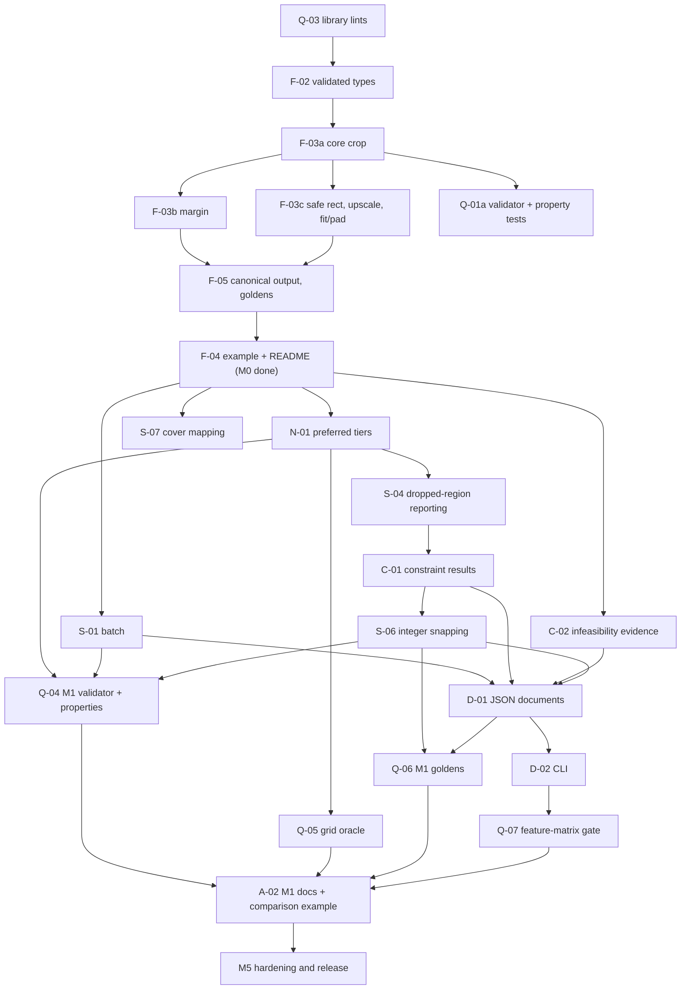

# Roadmap and issue plan

**Status:** the architecture is written and the M0 contract is accepted (ADR-001 to ADR-004). [ADR-005](decisions/ADR-005-initial-scope-static-cropping.md) sets the initial plan: **M0 and M1 are committed**, followed by **M5 hardening**. **M2, M3 and M4 are deferred**: they are kept below as a record, have no schedule, and gate nothing. The repository contains the design documents, an empty library crate and the quality gate (`./scripts/check.sh`, run by CI on Linux x86_64); **no crop operation is implemented yet** and no release has been made. Issues are tracked on [GitHub](https://github.com/drkarl/framemotive/issues); the [README](README.md) records repository status.

## How to read this plan

- **Committed** work is M0, M1 and M5, in that order. Everything else is **deferred**.
- Estimates are engineer-hours for one engineer who knows Rust and has read the architecture. Each is a range (low–high) that includes tests, documentation and one round of review fixes. They exclude waiting time and any scope not listed here. The planning figure for a milestone is the midpoint.
- Issue IDs (`F-02`, `N-01`, …) are stable names; GitHub numbers are linked in the [issue plan](#issue-plan). IDs without a number are drafts, not yet filed.
- Filing, reading or listing an issue does not authorize implementation.

## Summary

| Milestone | Status | Verifiable result | Tasks | Estimate (h) |
| --- | --- | --- | --- | --- |
| **M0** Static crop foundation | Committed | One target, required regions, margin, focus, safe rectangle, `max_upscale`; typed `Solved` / `InvalidInput` / `Infeasible`; independent recheck; canonical output; runnable example. | 8 | 60–98 |
| **M1** Constraint-aware static cropping | Committed | Several targets per request, preferred-region tiers, measured soft results, infeasibility evidence, versioned JSON and CLI, opt-in integer snapping, cover mapping. | 14 | 112–183 |
| **M5** Hardening and release | Committed (follows M1) | Fuzzing of the JSON path, benchmark baseline, all-platform golden check, packaging and compatibility policy. | 2 epics (≈6 tasks) | 31–53 |
| **Committed total** | | | | **203–334** (planning figure ≈ 270) |
| M2 Layered layout | **Deferred** | See [Deferred work](#deferred-work-not-scheduled). | — | 90–150 |
| M3 Time-varying composition | **Deferred** | | — | 100–170 |
| M4 Editable interchange | **Deferred** | | — | 76–145 |
| Deferred static extensions | **Deferred** | Target-space anchors, crop zoom range, per-shot sample boxes. | — | 24–42 |
| **Deferred total** | | | | 290–507, low confidence |

M0 plus M1 alone is 172–281 h (≈ 225). The deferred figures are order-of-magnitude only: their designs have not been through fixtures, and each would be re-estimated before scheduling.

## Implementation order and dependencies

Independent branches can run in parallel for more than one engineer; for one engineer the order is the M0 and M1 task tables below, top to bottom. Q-07 should be started when D-01 first adds a dependency, so the feature gate never lags behind the code.

## Quality gates

Every task ends with `./scripts/check.sh` green (rustfmt, clippy `-D warnings`, tests, rustdoc `-D warnings`, `cargo deny`). The gates below are additional, per milestone.

| Gate | When | What must hold |
| --- | --- | --- |
| Fixture bar | Every task | New behavior has fixtures with expected values derived by hand from the specification, stored beside the fixture, not copied from program output. |
| Independent recheck | From F-03a | `verify` is a separate module with no shared solver code; no `Solved` result leaves the library without passing it. |
| Panic freedom | From Q-03 | `unwrap`, `expect`, `panic` and `indexing_slicing` denied in non-test code; no unchecked numeric casts. |
| Golden determinism | M0 done (F-05), extended at M1 done (Q-06) | Golden `to_bits` fixtures pass per push on Linux x86_64. |
| Feature matrix | From D-01 (Q-07) | The gate builds, lints and tests the default, `json` and `cli` feature sets; the default build stays dependency-free. |
| Release platform check | Before any release (M5) | Golden fixtures also pass on Linux aarch64 (local `cross`), macOS and Windows (manual `release-platforms` workflow). |

## Application-ready foundation (M0)

**User-visible capability:** Given a static full-bleed source visual, target canvas, required source-space regions, and an optional focus point, calculate the maximal target-aspect crop that preserves every required region, or explain why that supported crop model cannot satisfy them. Return crop and affine transform as typed data. This beats a center crop when a caller-supplied subject sits off center and avoids false success when multiple regions cannot fit.

Source layout follows [architecture §5](architecture.md#5-modules-and-responsibility-boundaries): `geometry`, `request`, `validate`, `crop`, `verify`, `outcome`, `diagnostics`, with M0 using the subset it needs. Modules split only where tests and invariants benefit. A thin CLI and the versioned JSON contract are M1.

**First usable checkpoint (≈ 20–34 h, after F-03a).** Q-03, F-02 and F-03a give a Rust caller `crop()` for one target with required regions and an optional focus: a verified-by-fixture crop, or `Infeasible` with the conflicting extents. Margin, safe rectangle, `max_upscale`, canonical output and the example follow. The checkpoint is a working-tree state, not a separate release.

### M0 tasks (in order)

| Order | ID (issue) | Task | Depends on | Acceptance | Tests / gate | Est. (h) |
| --- | --- | --- | --- | --- | --- | --- |
| 1 | Q-03 (draft) | Enable panic-free lint denies for library code (architecture §2). | — | Denies active in `Cargo.toml`; test code exempt; gate green on the empty crate plus a sentinel module. | `check.sh`. | 2–4 |
| 2 | F-02 ([#4](https://github.com/drkarl/framemotive/issues/4)) | Validated `Canvas`, `Rect`, `Region`, margin, focus, `max_upscale`, safe rectangle; typed diagnostics; region clipping; ADR-002 tolerance function. | Q-03 | Every invalid input of the issue yields a stable diagnostic code; partly outside regions are clipped with `region_clipped`; minimum-extent rule enforced. | Boundary, fractional and numeric-resolution fixtures; every non-finite input. | 10–16 |
| 3 | F-03a ([#21](https://github.com/drkarl/framemotive/issues/21)) | Maximal crop, region union, hard interval, default focus, clamp, scale, affine map; `Solved` vs `Infeasible`; empty region list. | F-02 | Examples 1, 2 and 5. | Fixtures with hand-derived values; repeated runs identical. | 8–14 |
| 4 | F-03b ([#22](https://github.com/drkarl/framemotive/issues/22)) | Soft and hard margin; closed-form `m*`; per-region per-edge achieved margin and shortfall. | F-03a | Examples 3 and 8; large finite margins do not overflow; focus never reduces achieved margin. | Fixtures; extreme-margin cases. | 10–16 |
| 5 | F-03c ([#23](https://github.com/drkarl/framemotive/issues/23)) | Safe rectangle T, `max_upscale`, fit/pad alternative with per-constraint checks. | F-03a | Examples 6, 7 and 9; the alternative is never a returned decision. | Fixtures; T-caused emptiness names T. | 8–14 |
| 6 | Q-01a ([#25](https://github.com/drkarl/framemotive/issues/25)) | Independent geometry validator (`verify`) and `proptest` properties for invariants 1–8. | F-03a (extend with F-03b, F-03c) | Validator shares no solver code; failing seeds kept as fixtures. | Properties over generated finite inputs. | 10–16 |
| 7 | F-05 ([#26](https://github.com/drkarl/framemotive/issues/26)) | Canonical output (−0.0 normalized, field and diagnostic order) and golden `to_bits` fixtures. | F-03b, F-03c | Goldens for examples 1–9 pass per push on Linux x86_64; no −0.0 in output. | Goldens; ordering stable across runs. | 8–12 |
| 8 | F-04 ([#6](https://github.com/drkarl/framemotive/issues/6)) | Runnable synthetic example, README status limited to implemented behavior. | F-03 parent (#5), F-05 | Example runs against the real API and is checked in a test; README states one static layer, no rendering or detection. | `cargo run --example`; doctests. | 4–6 |

**M0 total: 60–98 h.** [F-03](https://github.com/drkarl/framemotive/issues/5) (#5) is the parent of F-03a to F-03c and closes with them. F-01 ([#3](https://github.com/drkarl/framemotive/issues/3)), Q-00 ([#24](https://github.com/drkarl/framemotive/issues/24)) and A-01 ([#2](https://github.com/drkarl/framemotive/issues/2)) are done.

**Acceptance examples (to become synthetic fixtures):**

1. Source `1920×1080`, target `1080×1920`, required ROI `[1200, 1400]×[300, 800]`, no focus: center crop hides part of the ROI. The crop is `607.5×1080`; the hard x-interval is `[792.5, 1200]`; the union center is x = 1300, so the desired origin is `1300 − 303.75 = 996.25`, inside the interval. Result: crop x `996.25..1603.75`, y `0`, `Solved`, subject centered rather than flush to the edge.
2. Same canvases, ROI spanning source x coordinates `200..1600`: the required width exceeds any full-bleed portrait crop; result is `Infeasible` with actual versus available width and a fit/pad diagnostic (`s_fit = 0.5625`, no horizontal bars, vertical bars totaling `656.25 + 656.25 = 1312.5` target pixels); no `max_upscale` or T is set, so the unvalidated fit/pad alternative satisfies the hard constraints.
3. Same canvases, ROI `[1850, 1900]×[300, 800]`, margin `100` extending past the right source edge: by default `Solved` with crop x `1312.5..1920` and a reported right-edge shortfall (achieved `20`, requested `100`, shortfall `80`). In `hard` margin mode: `Infeasible`, naming region ID, margin and the right edge. A negative or nonfinite margin is `InvalidInput`.
4. Nonfinite coordinates, zero canvas dimension, duplicate region IDs, a wholly out-of-bounds region, or a region whose clipped portion is below the minimum extent: typed `InvalidInput` diagnostics. A region partly outside the source is clipped with a `region_clipped` diagnostic carrying the original bounds.
5. Empty ROI list with a preferred point: deterministic preferred-center crop; repeated runs yield identical geometry.
6. Source `1280×720`, target `1080×1920`, `max_upscale` `2.0`: the maximal crop is `405×720` and `s = 1080/405 = 2.666…` exceeds the limit, so `Infeasible` with measured scale and limit (and a fit/pad diagnostic: `s_fit = 0.84375 ≤ 2.0`, vertical bars totaling `1312.5` target pixels; no T, so the alternative satisfies the hard constraints).
7. Source `1920×1080`, target `1080×1080` (crop `1080×1080`, `s = 1`), required ROI `[1500, 1700]×[300, 700]`, focus `(1000, 540)`, safe rectangle `T = [100, 980]×[100, 980]`: the hard x-interval from source and ROI containment is `[620, 840]`; T adds `x ≤ 1500 − 100 = 1400` and `x ≥ 1700 − 980 = 720`, giving `[720, 840]`. The focus-derived origin `1000 − 540 = 460` clamps to `720`; crop x `720..1800`, y `0`; the ROI maps to `[780, 980]×[300, 700]`, inside T. Without T the origin would be `620`.
8. Source `1000×1000`, target `500×1000`, required ROI `[300, 700]×[200, 800]`, margin `100`, focus `(0, 500)`. x: `cw = 500`, hard interval `[200, 300]`, `dL = dR = 300`; `lo = 200 + m'`, `hi = 300 − m'`, so `m* = 50` and `M = [250, 250]`: crop x `250..750`, achieved margin `50` left and right, shortfall `50` each (requested `100`); the focus origin `0 − 250` clamps into `M`. y: crop height `1000 = H`, so y `0`; top/bottom achieved margin `200`, no shortfall. `Solved`. In `hard` margin mode: `Infeasible` (`m* = 50 < 100`).
9. Source `1000×1000`, target `1000×1000`, `max_upscale` `0.5`, any ROI: `s = 1 > 0.5`, so `Infeasible`; `s_fit = 1 > 0.5`, so the fit alternative is reported as violating `max_upscale`.

**M0 completion bar:** Tests compare source containment, aspect, all required ROI containment, affine mapping, status and diagnostic codes using independent assertions. README clearly says one static layer only. A normal `cargo test` and example run pass on supported platforms. Canonical output contract (ADR-002): golden fixtures record exact `f64` bit patterns (`to_bits` hex) and per-push CI on Linux x86_64 compares them; Linux aarch64 (local `cross`), macOS and Windows (manual workflow) must also pass before release, so M0 decisions are bitwise identical on all four. No rendering or editor integration is claimed.

## Constraint-aware static cropping (M1)

**User-visible capability:** For one static source image or shot and several target canvases, return one verified crop per target (or an honest refusal with measured evidence), where required regions are never cut, preferred regions are kept tier by tier when possible, and every soft shortfall is measured. A CI job can run the CLI and fail when a rendition would lose a required region; raster pipelines get a revalidated integer crop; layout code gets a `cover` position. Specified in [architecture §3 and §7](architecture.md#7-algorithms) and [requirements M1-01 to M1-08](requirements.md#m1-functional-requirements-proposed-adr-005).

**Worked example (becomes a fixture in S-01/N-01/S-04, [architecture §14](architecture.md#14-initial-usable-implementation-slice)):** source `1920×1080`, required `product`, preferred tier-1 `logo`, targets `story` `1080×1920` and `square` `1080×1080`. `story` drops the logo (visible fraction 0) and crops `x = 996.25..1603.75`; `square` keeps it and crops `x = 840..1920`.

Three internal slices, each ending with `check.sh` green and README status updated to implemented behavior only:

1. **Core semantics (Rust API):** S-01, N-01, S-04, C-01, C-02. A caller can run the headline use case in Rust.
2. **Integration:** S-06, S-07, D-01, D-02. A CI job can run the CLI with `--snap outward`.
3. **Evidence and polish:** Q-04, Q-05, Q-06, Q-07, A-02.

### M1 tasks (in order)

| Order | ID (issue) | Task | Depends on | Acceptance | Tests / gate | Est. (h) |
| --- | --- | --- | --- | --- | --- | --- |
| 1 | S-01 ([#27](https://github.com/drkarl/framemotive/issues/27)) | `Target`, `CropBatch`, `BatchOutcome`, `crop_batch`; shared-field validation once; expansion into per-target `CropRequest`. | F-04 | Mixed solvable/infeasible targets give independent outcomes in input order; per-target result is bit-identical to `crop` on the expanded request; request not mutated. | Fixtures; equality property; duplicate target IDs. | 8–14 |
| 2 | N-01 ([#8](https://github.com/drkarl/framemotive/issues/8)) | `Requirement` on `Region`; tier-by-tier all-or-nothing selection (§7.3); margin and default focus on the kept union; tie rules. | F-04 | A tier is kept for one target and dropped for another; outcome independent of region order and IDs; required regions never dropped; all-preferred request valid. | Fixtures incl. architecture §14; order-permutation test. | 10–16 |
| 3 | S-04 ([#30](https://github.com/drkarl/framemotive/issues/30)) | Report dropped preferred regions with tier, visible fraction and per-edge cut distance; `preferred_region_dropped` warning; one region per tier reproduces S-04's priority-ordered subset. | N-01 | Every dropped region carries measurements; `Solved` with warning, never silent. | Fixtures; visible-fraction hand values. | 5–8 |
| 4 | C-01 (draft) | `ConstraintResult` for every constraint (region, margin, safe rectangle, `max_upscale`, focus): hardness, status, measurements. | N-01, S-04 | Each `Solved` fixture lists every constraint with status and measurements; canonical order. | Fixtures for each kind and status. | 8–12 |
| 5 | C-02 (draft) | Infeasibility evidence (§7.4): interval terms, conflicting pair, binding region IDs, gap, needed relaxation; fit/pad alternative kept. | F-04 | Width, height, safe-rectangle, hard-margin and upscale fixtures check each measurement; ties list all binding regions sorted. | Fixtures; no claim of a minimal conflicting set. | 10–16 |
| 6 | S-06 (draft) | `PixelCrop` and `SnapPolicy` (`Outward` default, `Nearest`): integer crop, per-axis scale, aspect error, revalidation, `snap_constraint_violation`; `floor`/`ceil` confined to the snapping module. | C-01 | `Outward` never loses a kept region; violations reported and `satisfies_hard_constraints()` is false, never relabelled. | Fractional-edge, source-edge and safe-rectangle fixtures; lint confines `floor`/`ceil`. | 10–16 |
| 7 | S-07 (draft) | `cover_position()` for CSS `object-fit: cover` (§7.6). | F-04 | Formula fixtures including the zero-slack axis (0.5). | Fixtures; doctest. | 3–5 |
| 8 | D-01 ([#9](https://github.com/drkarl/framemotive/issues/9)) | `json` feature: versioned request and report documents as separate DTOs, input limits, `deny_unknown_fields`, schema checks, exact `f64` round trip. | S-01, C-01, C-02, S-06 | Round trip, malformed, unknown-field, wrong-version and over-limit documents behave per architecture §8 and §11; `f64` round-trips bit-exactly. | Bit-exact round-trip test; limit tests; canonical report order. | 14–22 |
| 9 | D-02 (draft) | `framemotive` binary (`cli` feature): `crop`, `check`, `--version`, `--snap`, `--fail-on`, `--output`, text/JSON formats; exit codes 0–3. | D-01 | Built binary run on fixture documents gives specified bytes and exit codes; control characters in IDs are escaped in text output; README command runs. | CLI tests via `CARGO_BIN_EXE_framemotive`. | 10–16 |
| 10 | Q-04 (draft) | Extend `verify` (invariants 5–7 for kept preferred regions, batch equality) and property tests: determinism, permutation invariance, lower-tier addition, `Outward` snapping. | N-01, S-01, S-06 | Properties pass; failures keep seed and input. | `proptest`. | 8–14 |
| 11 | Q-05 (draft) | Brute-force oracle on small integer canvases (1/8-pixel origin grid) for invariant 9: no better lexicographic origin exists; empty-interval cases have no feasible grid origin. | N-01 | Oracle shares no code with `crop`; covers M0 margin/focus selection and tiers. | Oracle test run in `check.sh` within a time budget. | 8–14 |
| 12 | Q-06 (draft) | Canonical output and goldens for batch, tier, snapping and JSON report cases (M1-08). | S-06, D-01 | Goldens for the M1 fixtures; bit-identical across reruns; no −0.0. | Golden `to_bits`; JSON byte comparison. | 6–10 |
| 13 | Q-07 (draft) | Quality gate covers `--no-default-features`, `json`, `cli`; `cargo deny` allow-list and licence review for `serde`, `serde_json`, `clap`. | D-01 (start), D-02 | `check.sh` builds, lints, tests and documents every feature set; default build has no dependencies. | `check.sh`, CI run. | 4–8 |
| 14 | A-02 (draft) | Documentation: README status, recipes for libvips, sharp, `image` and CSS, and the comparison example (center crop vs union-centred crop vs FrameMotive) with the proportion of differing cases. | Q-04, Q-05, Q-06, Q-07 | README lists only implemented behavior; every example is generated by real code; comparison reported, not used as a gate. | Doctests; example run in tests; rustdoc `-D warnings`. | 8–12 |

**M1 total: 112–183 h** (≈ 147). M1 is complete when the [M1 completion bar](#m1-completion-bar) holds.

#### M1 completion bar

- Static fixtures show tier behavior, tie behavior, useful infeasibility evidence, revalidated snapping and no silent hard-constraint violation.
- The CLI runs a synthetic renditions document end to end with the documented exit codes.
- `check.sh` is green for every feature set; goldens pass on Linux x86_64 per push.
- README, architecture and requirements describe implemented behavior only.

## Hardening and release (M5, follows M1)

Not gating M1; scheduled after it because a first release needs it. Existing epics [Q-01](https://github.com/drkarl/framemotive/issues/17) (#17) and [Q-02](https://github.com/drkarl/framemotive/issues/18) (#18) cover the work; split them into issues when M1 closes.

| Task | Covered by | Acceptance | Est. (h) |
| --- | --- | --- | --- |
| Fuzz the JSON-to-outcome path (`cargo-fuzz`, nightly, outside the stable gate); no panic or unbounded allocation on any input | Q-01 | A documented fuzz run of agreed duration finds no crash; corpus kept as fixtures | 8–12 |
| Benchmark harness with recorded baseline environment; budgets only after measurement | Q-01 | Benchmarks run; baseline recorded in docs; budget set from data | 6–10 |
| Release platform check: golden fixtures on Linux aarch64 (`cross`), macOS and Windows (`release-platforms`) | Q-02 | All four platforms bit-identical, recorded in the release notes | 4–8 |
| Packaging: licence selection, crate metadata, MSRV and semver policy, changelog, JSON schema versioning note | Q-02 | `cargo publish --dry-run` clean; compatibility policy documented | 8–14 |
| Dependency and licence review, public-fixture review, docs.rs rendering check | Q-02 | Review recorded; no unreviewed transitive native requirement | 3–5 |
| Publish dry run and release checklist | Q-02 | Checklist executed end to end without publishing, or published on explicit decision | 2–4 |

**M5 total: 31–53 h.**

## Technical risks

| Risk | Likelihood / impact | Mitigation |
| --- | --- | --- |
| Interval emptiness at exact boundaries: a hard interval that is empty by round-off differs from the tolerance used for rechecks (ADR-002), so the solver and `verify` could classify the same case differently. | Medium / high | Decide in F-03a that emptiness is tested exactly on validated inputs and tolerance applies only after solving; boundary fixtures at equality; oracle (Q-05) and properties check agreement. |
| Closed-form `m*` and caps at source edges (F-03b) are easy to get subtly wrong. | Medium / medium | Hand-derived examples 3 and 8; property tests; grid oracle; independent `verify`. |
| Bit-identical output across platforms. Only IEEE basic operations are used, so divergence is unlikely, but compilers and targets differ. | Low / high | `mul_add` and transcendental functions banned by clippy; goldens on four platforms before release; `cross` aarch64 relies on a container and QEMU, so budget time for tooling trouble. |
| All-or-nothing tiers may be too coarse for real layouts. | Medium / low | Documented default (architecture question 2); callers use more tiers; per-region selection stays a recorded alternative. |
| Integer snapping can violate `max_upscale` or the safe rectangle at tight margins, and users may misread a reported violation. | Medium / medium | Violations are diagnostics with measured excess and a false `satisfies_hard_constraints()`; the CLI exits 1; documentation shows the failure case. |
| Usefulness: the crop may differ little from a union-centred crop for typical inputs. | Medium / medium | Value is concentrated in edges, safe areas, upscale limits and refusals; A-02 measures the proportion on synthetic layouts. Not a gate. |
| JSON schema churn before 1.0 and added dependencies (`serde`, `clap`, MSRV 1.94, `cargo deny` allow-list). | Low / low | Separate DTOs, versioned schema, features off by default, Q-07 gate. |
| Estimates assume one engineer with full context; part-time work stretches the calendar, not the hours. | — | Ranges kept visible; re-estimate at the end of M0 with measured velocity. |

## Deferred work (not scheduled)

Deferred by ADR-005: not in the committed plan, no schedule, and none gates M1 or a first release. The issues stay open and carry the `deferred` label (see [issue plan](#issue-plan)). Designs, acceptance criteria and issue text are kept unchanged as a record. Reopening any item needs its own decision record with concrete fixtures: a demonstrated need for independently movable overlays or moving-subject reframing, or a consumer that requires a maintained editor adapter.

| Milestone | Issues | Scope | Estimate (h), low confidence |
| --- | --- | --- | --- |
| M2 Layered layout | N-02 [#10](https://github.com/drkarl/framemotive/issues/10), N-03 [#11](https://github.com/drkarl/framemotive/issues/11) | Independently movable captions and graphics, per-layer safe areas, collision avoidance; solver benchmark and selection. | 90–150 |
| M3 Time-varying composition | T-00 [#12](https://github.com/drkarl/framemotive/issues/12), T-01 [#13](https://github.com/drkarl/framemotive/issues/13), T-02 [#14](https://github.com/drkarl/framemotive/issues/14) | Caller-supplied subject tracks, cut-aware smoothing, keyframes, between-sample validation. | 100–170 |
| M4 Editable interchange | E-01 [#7](https://github.com/drkarl/framemotive/issues/7), E-02 [#15](https://github.com/drkarl/framemotive/issues/15), E-03 [#16](https://github.com/drkarl/framemotive/issues/16) | Editor save/reopen spike, versioned decision document, one maintained adapter. | 76–145 |
| Static extensions | S-02 [#28](https://github.com/drkarl/framemotive/issues/28), S-03 [#29](https://github.com/drkarl/framemotive/issues/29), S-05 [#31](https://github.com/drkarl/framemotive/issues/31) | Target-space anchors, crop zoom range, per-shot sample boxes. Each needs a semantics decision first; S-05 may reduce to a documentation note because several required regions already yield their union. | 24–42 |

The early editor spike (E-01) no longer precedes any committed work. The solver comparison in N-02 is not planned: the interval geometry stays the only algorithm unless layered work is reopened.

## Issue plan

Each issue is deliberately bounded. Dependencies refer to the IDs below; linked GitHub issues contain acceptance criteria. "Draft" means not yet filed. Status: **done**, **M0**/**M1**/**M5** committed, **deferred**.

| ID / dependency | Status | Candidate issue and scope |
| --- | --- | --- |
| [A-01](https://github.com/drkarl/framemotive/issues/2) / none | done | Record the accepted M0 contract in ADR-001 to ADR-004. |
| [F-01](https://github.com/drkarl/framemotive/issues/3) / A-01 | done | Cargo library skeleton. |
| [Q-00](https://github.com/drkarl/framemotive/issues/24) / F-01 | done | Quality gate and per-push Linux CI; manual macOS/Windows workflow; documented local `cross` aarch64 command. |
| Q-03 draft / Q-00 | M0 | Panic-free lint denies for library code. |
| [F-02](https://github.com/drkarl/framemotive/issues/4) / Q-03 | M0 | Validated `Canvas`, `Rect`, `Region` and typed diagnostics. |
| [F-03](https://github.com/drkarl/framemotive/issues/5) / F-02 | M0 | Parent of F-03a, F-03b and F-03c. |
| [F-03a](https://github.com/drkarl/framemotive/issues/21) / F-02 | M0 | Core maximal crop and affine mapping (examples 1, 2, 5). |
| [F-03b](https://github.com/drkarl/framemotive/issues/22) / F-03a | M0 | Soft and hard margin, `m*` (examples 3, 8). |
| [F-03c](https://github.com/drkarl/framemotive/issues/23) / F-03a | M0 | Safe rectangle, `max_upscale`, fit/pad alternative (examples 6, 7, 9). |
| [Q-01a](https://github.com/drkarl/framemotive/issues/25) / F-03a | M0 | Independent validator and property tests. |
| [F-05](https://github.com/drkarl/framemotive/issues/26) / F-03b, F-03c, Q-00 | M0 | Canonical output and golden `to_bits` fixtures. |
| [F-04](https://github.com/drkarl/framemotive/issues/6) / F-03, F-05 | M0 | Runnable example and accurate README. M0 complete. |
| [S-01](https://github.com/drkarl/framemotive/issues/27) / F-04 | M1 | Batch targets. |
| [N-01](https://github.com/drkarl/framemotive/issues/8) / F-04 | M1 | Preferred-region tiers, soft semantics for the static crop. |
| [S-04](https://github.com/drkarl/framemotive/issues/30) / N-01 | M1 | Dropped-region reporting; realizes priority-based dropping as preferred tiers (ADR-005). |
| C-01 draft / N-01, S-04 | M1 | `ConstraintResult` for every constraint. |
| C-02 draft / F-04 | M1 | Infeasibility evidence. |
| S-06 draft / C-01 | M1 | Integer snapping (`PixelCrop`). |
| S-07 draft / F-04 | M1 | Cover-position mapping. |
| [D-01](https://github.com/drkarl/framemotive/issues/9) / S-01, C-01, C-02, S-06 | M1 | Versioned JSON request and report documents. |
| D-02 draft / D-01 | M1 | CLI binary and exit codes. |
| Q-04 draft / N-01, S-01, S-06 | M1 | M1 validator and property tests. |
| Q-05 draft / N-01 | M1 | Brute-force grid oracle. |
| Q-06 draft / S-06, D-01 | M1 | M1 golden fixtures. |
| Q-07 draft / D-01, D-02 | M1 | Feature-matrix gate and dependency review. |
| A-02 draft / Q-04, Q-05, Q-06, Q-07 | M1 | M1 documentation and comparison example. |
| [Q-01](https://github.com/drkarl/framemotive/issues/17) / M1 | M5 | Fuzzing and benchmarks (Q-01a is M0). |
| [Q-02](https://github.com/drkarl/framemotive/issues/18) / Q-01 | M5 | Release criteria, packaging, compatibility policy. |
| [E-01](https://github.com/drkarl/framemotive/issues/7) / F-04 | deferred | Editor save/reopen spike. |
| [S-02](https://github.com/drkarl/framemotive/issues/28) / F-04 | deferred | Target-space anchors. |
| [S-03](https://github.com/drkarl/framemotive/issues/29) / F-04 | deferred | Crop zoom range. |
| [S-05](https://github.com/drkarl/framemotive/issues/31) / F-04 | deferred | Per-shot crop from sample boxes. |
| [N-02](https://github.com/drkarl/framemotive/issues/10) / N-01, E-01 | deferred | Layered-layout solver benchmark. |
| [N-03](https://github.com/drkarl/framemotive/issues/11) / N-02 | deferred | Bounded multi-layer placement. |
| [T-00](https://github.com/drkarl/framemotive/issues/12) / F-04 | deferred | Subject-track contract. |
| [T-01](https://github.com/drkarl/framemotive/issues/13) / T-00 | deferred | Trajectories and cut-aware smoothing. |
| [T-02](https://github.com/drkarl/framemotive/issues/14) / T-01 | deferred | Temporal crop decisions and keyframes. |
| [E-02](https://github.com/drkarl/framemotive/issues/15) / E-01, D-01 | deferred | Versioned decision document for editors. |
| [E-03](https://github.com/drkarl/framemotive/issues/16) / E-02 | deferred | First maintained editor adapter. |

**Next implementable candidates:** Q-03, then F-02, F-03a, F-03b, F-03c, Q-01a, F-05, F-04, each as a separate task (F-01 and Q-00 are done). M1 starts after F-04. Filing or reading an issue does not authorize implementation.

## Accepted M0 decisions

1. Rust is the primary core. M0 uses a typed library and example with no optimizer or CLI; the versioned CLI follows in M1.
2. M0 handles one full-bleed visual, maximal source crop, required ROIs, optional uniform margin (soft by default) and preferred focus, optional `max_upscale` and target safe rectangle. Padding and multi-layer placement remain outside M0.
3. Canvas dimensions are `1..=65_536` per axis. ADR-002 defines post-computation tolerance and a minimum required-region extent. Margin is a soft preference by default: a margin extending past the source yields `Solved` with reported shortfall, and is model-scoped `Infeasible` only in `hard` margin mode. Partly out-of-frame regions are clipped with a diagnostic.
4. The M0 public types and three outcomes are recorded in ADR-003; `Unsupported` and `Indeterminate` remain future outcome names.

## Initial-scope decision

[ADR-005](decisions/ADR-005-initial-scope-static-cropping.md) makes M0 + M1 the initial plan, adds batch targets, preferred-region tiers, infeasibility evidence, integer snapping and cover mapping to M1, and lists the exact ADR-002, ADR-003 and ADR-004 statements it supersedes. M2, M3, M4 and the early editor spike are deferred possibilities; M5 hardening may follow M1 directly.

## Source index

Primary public material informing this design: [MediaPipe AutoFlip](https://github.com/google-ai-edge/mediapipe/blob/master/docs/solutions/autoflip.md), [Premiere Auto Reframe](https://helpx.adobe.com/premiere/desktop/add-video-effects/commonly-used-effects/add-auto-reframe-effect-to-a-sequence.html), [OpenTimelineIO](https://opentimelineio.readthedocs.io/en/latest/), [FilmCraft public architecture](https://github.com/storytold/filmcraft/blob/main/docs/architecture.md), [Rust `cassowary`](https://docs.rs/cassowary/latest/cassowary/), [`good_lp`](https://github.com/rust-or/good_lp), [Clarabel](https://clarabel.org/stable/), [`argmin`](https://argmin-rs.org/), [OR-Tools CP-SAT](https://developers.google.com/optimization/cp/cp_solver), [`kurbo`](https://docs.rs/kurbo/latest/kurbo/), [`nalgebra`](https://www.nalgebra.rs/docs/), [`parry2d`](https://docs.rs/parry2d/latest/parry2d/), and [`splines`](https://docs.rs/splines/latest/splines/). Their documented capabilities have not been executed in this project; pin versions and repeat the dependency review when implementation begins.
